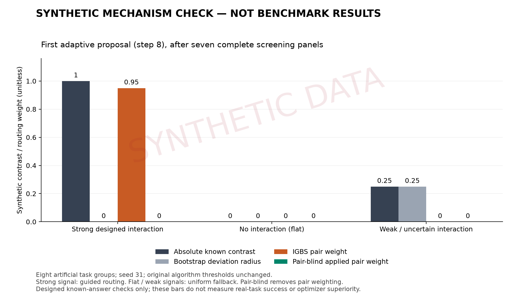

# IGBS 十分钟简版：受控合成机制验证

**状态：已执行并通过。数据类型：合成。真实模型调用：0；付费 API 费用：$0。**

本记录验证实际 IGBS 代码的自适应决策行为，不属于 SkillsBench 真实效果实验，也不证明 IGBS 优于 BO、Random 或 pair-blind。原真实实验和已经交付的补充 ZIP 均保持原样。

## 实验规模与方法

运行 3 个预声明场景 × IGBS / pair-blind 两个方法 × 每方法 10 个配置 × 8 个人工任务组，共 **60 个完整配置面板、480 次合成任务评估**。种子固定为 31，使用当前三参数 27 配置空间（low/medium/high；reserve 16384/360000/375000；recent 4000/10000/20000）。

所有六条运行路径均完成 **7 次 screen → 第 8 次 pair → 第 9 次 single → 第 10 次 global**，每条路径配置不重复，ask/tell 日志哈希链与完成状态均通过核验。两方法的前七个初始化配置相同，分别保留自己的观测。

算法运行实测耗时 **0.262 秒**，包括导入、合成计算、日志和源码核查；单独的绘图与打包耗时未计入。运行器禁止网络连接和子进程调用，未构造真实 evaluator。运行前后核对的 **165 个受保护源文件均未变化**。

## 合成目标如何构造

目标参数对是 `defaultThinkingLevel × compaction.reserveTokens`。根据固定种子的初始化设计，目标替代取值为 `{"defaultThinkingLevel": "high", "compaction.reserveTokens": 360000}`。

- 强交互：只有该参数对同时达到目标替代取值，八个人工组才都返回成功。
- 无交互：所有配置、所有人工组均返回失败，形成平坦目标。
- 弱不确定交互：同一参数对达到目标时，只有第 0、1 两个人工组返回成功。

信号位置被**有意对齐初始化设计**，用于构造答案已知的机制检查。八个人工组不能视为八份独立真实实验证据；bootstrap 与稳定性数值只是算法对该合成输入的计算结果，不能解释为真实效果的统计置信度。所有 cost/time 破平分输入固定为零，实际离线耗时另记。

## 第一次自适应决策的实测输出

| 场景 | 绝对交互 contrast | Bootstrap 半径 | IGBS 交互权重 | pair-blind 生效权重 | IGBS 路由 |
|---|---:|---:|---:|---:|---|
| 强交互 | 1.00 | 0.00 | 0.95 | 0.00 | `positive_stable_weight` |
| 无交互 | 0.00 | 0.00 | 0.00 | 0.00 | `unidentified_or_unreliable_uniform` |
| 弱不确定交互 | 0.25 | 0.25 | 0.00 | 0.00 | `unidentified_or_unreliable_uniform` |

强交互场景中，IGBS 选中了注入信号的参数对，使用 `positive_stable_weight`；pair-blind 将参数对权重屏蔽后使用 `pair_blind_uniform`。无交互和弱不确定交互场景中，IGBS 的参数对权重均为零，两方法的十配置轨迹一致，符合均匀回退规则。门槛保持原值：8 组、实用阈值 0.05、稳定性阈值 0.8、bootstrap 2000 次。

## 可以写入报告的结论

> 我们在三个受控合成场景上验证了 IGBS 的实现：算法完成七点初始化后进入 pair/single/global 自适应决策；对强而稳定的已知交互使用加权参数对选择；在无交互或不确定信号下回退到均匀选择。配对消融验证了 pair-blind 能移除交互权重。该实验提供机制实现正确性的证据，不提供真实任务上的性能优势证据。

英文版本：

> We executed a controlled synthetic validation of the unchanged IGBS implementation using three designed objectives, eight artificial task groups, and a matched pair-blind ablation. All six runs completed seven screening panels followed by pair, single, and global proposals (60 configuration panels and 480 synthetic evaluations in total). In the strong-interaction case, IGBS selected the injected parameter pair with a routing weight of 0.95, whereas the ablation used uniform pair selection. Flat and weak-signal cases produced zero pair weights and the expected uniform fallback. These known-answer checks validate routing behavior and the ablation implementation; they do not establish performance gains on real SkillsBench tasks or superiority over another optimizer.

## 复核文件与复现

- `run-output/protocol.json`：在评估前写入的场景规则、种子、参数空间与源码哈希。
- `run-output/results.json`：完整结果与断言核验。
- `run-output/rounds.csv`：全部 60 轮配置、合成分数和路由。
- `run-output/<scenario>/<method>/optimizer-trace.jsonl`：完整 contrast、稳定性、权重、ask/tell 与哈希链。
- `run-output/first-adaptive-decision.csv`：上表的机器可读数据。
- `run-output/mechanism-check.png` / `.pdf`：已标注合成数据的图表。

在原项目中，用 `.venv/bin/python experiments/igbs-synthetic-demo-20261030/run_demo.py` 可运行。已有 `run-output` 时脚本拒绝覆盖；复现请仅复制 `run_demo.py` 和 `render_report.py` 到新的同级目录（不复制 `run-output`），再运行新副本。它依赖同项目的 `hpo/` 和 `experiments/igbs-validation-20261030/optimizers.py`，不是独立安装的 benchmark runtime。绘图使用已有的 Python 3.14 / matplotlib 运行 `render_report.py`，无需安装或付费模型。

## Public package layout note (31 October 2026)

The recorded outputs above are unchanged. This public copy retains the original runner as a source snapshot. Its original execution path and private source-protection inventory are intentionally absent, so the original rerun command is not directly executable in this export. The supplementary optimizer implementation is included under `experiments/igbs-validation-20261030/`. `DELIVERY_MANIFEST.json` records historical source-layout hashes; use the root `UPLOAD_MANIFEST.json` to verify this public package. Duplicate evidence ZIPs are omitted.
